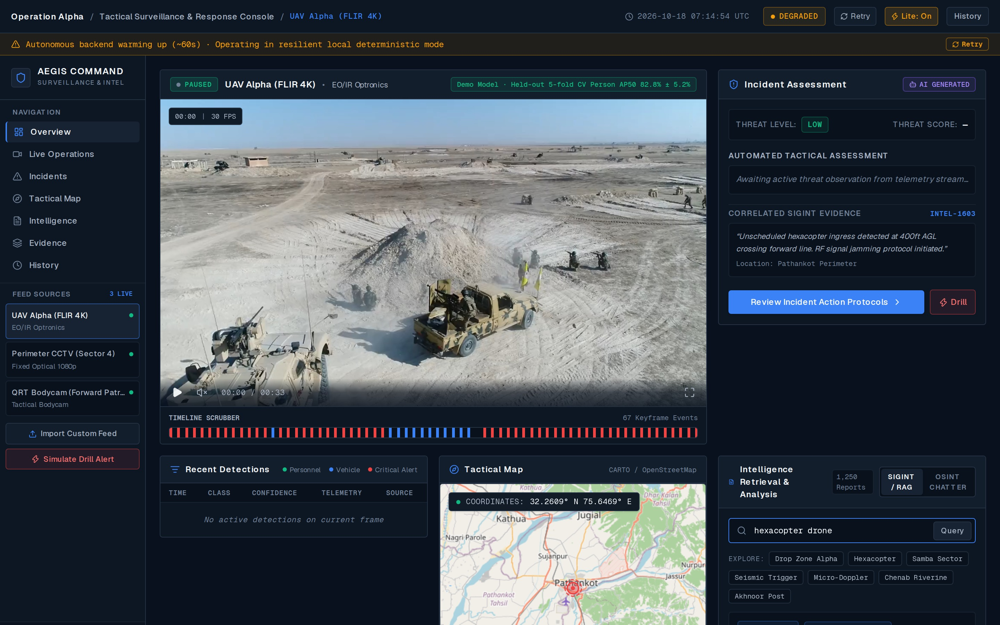
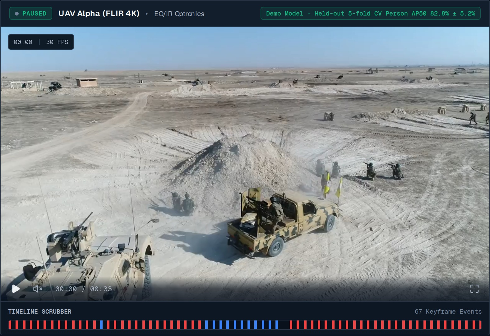
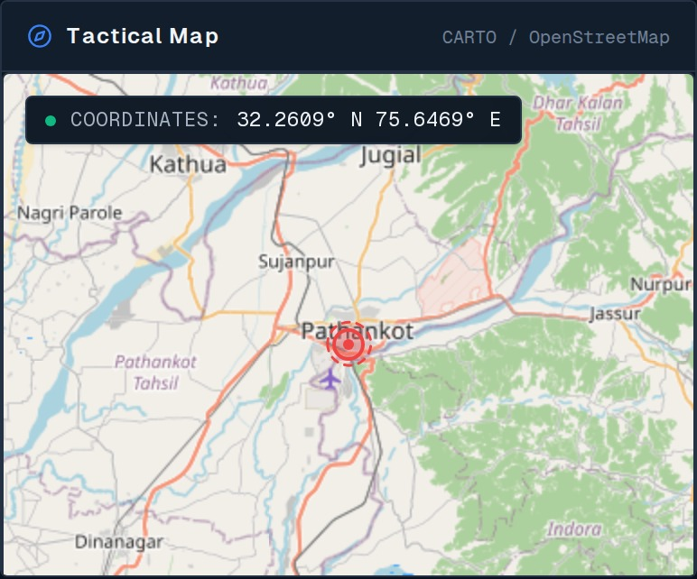
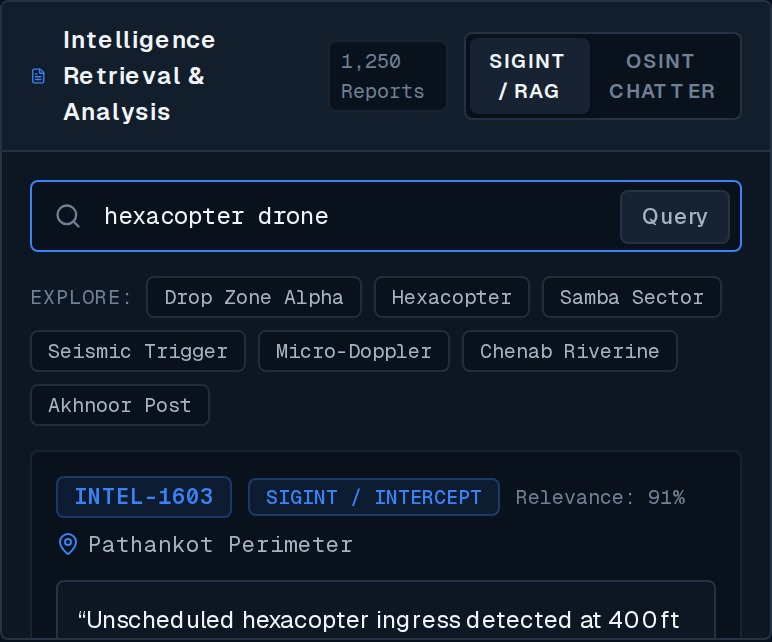
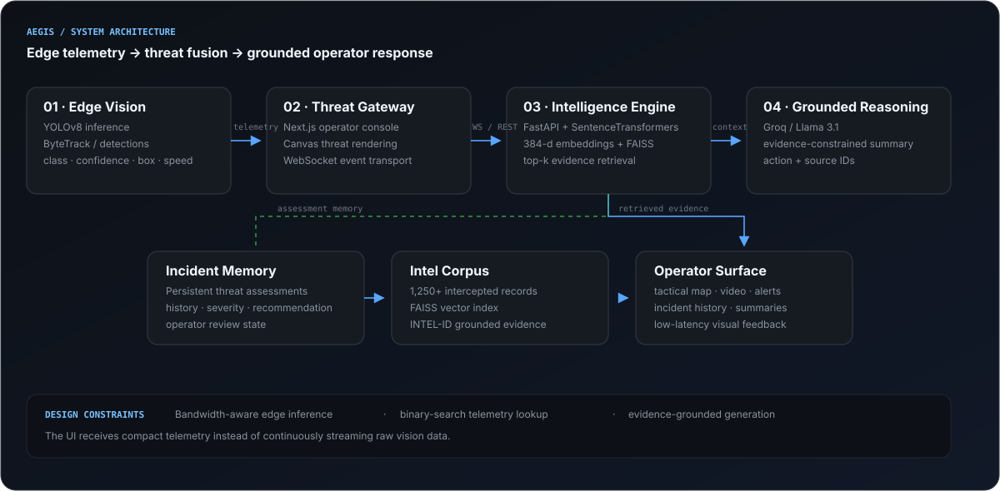

<div align="center">

# AEGIS COMMAND
### AI-Assisted Tactical Intelligence & Decision Support

<p align="center">
  <a href="https://aegis-command-ui.vercel.app"></a>
  
  
  
</p>

**Computer Vision · Retrieval-Augmented Intelligence · Real-Time Telemetry · Operator Decision Support**

Built by **Tanmay Jain · Aryan Garg · Rishabh Bansal**

🔗 **Live Tactical Web Console:** [https://aegis-command-ui.vercel.app](https://aegis-command-ui.vercel.app)

*Prototype · decision-support demo · human in the loop*

</div>

---

> **Aegis Command turns fragmented surveillance signals into an evidence-grounded operational picture.**
>
> Video detections, intercepted intelligence and prior incidents become one operator-facing workflow instead of three disconnected sources of information.

---

## The Problem

Tactical monitoring environments frequently generate more concurrent data than a human operator can manually synthesize under time constraints:

- **Operator overload:** Continuous high-resolution video streams require intense visual concentration, making sustained manual tracking difficult.
- **Alert fatigue:** Repetitive detection pings without contextual grounding lead to cognitive saturation and slower reaction times.
- **Fragmented context:** Sensor telemetry, intelligence intercepts, and historical incident logs typically reside across disconnected databases and consoles.
- **Slow reporting:** Manually cross-referencing an observed contact against external logs introduces delays before an authorized response can occur.

---

## What It Does Today

Aegis Command provides a functional demonstration of a decision-support workflow:

1. **Synchronized Telemetry Replay:** Streams surveillance video (`frontend/public/feeds/uav-alpha/video.mp4`, with fallback to `drone_feed.mp4`) while drawing precomputed bounding boxes and kinematics (`detections.json` generated by Phase 6 fine-tuned model `aegis_demo_full_last.pt`) onto an HTML canvas overlay synchronized to playback time.
2. **Simulated Tactical Mapping:** Linearly maps 2D detection coordinates into a bounded synthetic operating area displayed on an interactive Leaflet map.
3. **Live WebSocket Ingestion:** Forwards active detection events (`class`, `confidence`, `speed_kmh`, `direction`, simulated coordinates) to a FastAPI backend over `/ws/threat-engine`.
4. **Vector Intelligence Retrieval:** Embeds detection queries and queries a 1,251-record synthetic SIGINT dataset stored in a FAISS index, retrieving relevant records with calibrated thresholding (`RELEVANCE_THRESHOLD = 0.20`, [`backend/main.py:162`](backend/main.py#L162)) and domain pre-filtering.
5. **Grounded Threat Synthesis:** Generates a structured JSON assessment (`threat_level`, `score`, `reasoning`, `recommended_action`) using Groq (`llama-3.1-8b-instant` or configured `GROQ_MODEL`) based on retrieved context, with automatic deterministic rule-based fallback if the LLM is unconfigured or unavailable.
6. **Incident Memory Audit:** Automatically logs incoming telemetry, retrieved citations, and generated assessments to an SQLite database (`incidents.db`) for post-incident review.

---

## Operator Interface

The web console provides a consolidated view: **detect → correlate → retrieve → assess**.

<p align="center">
  
</p>

The dashboard combines replay video, detection telemetry, tactical mapping, intelligence retrieval and threat state in one operating surface.

<table>
<tr>
<td width="50%" align="center">
  
  <br/><b>01 · Video & Detection</b><br/>
  <sub>YOLO-derived detection telemetry rendered over the surveillance feed.</sub>
</td>
<td width="50%" align="center">
  
  <br/><b>02 · Tactical Map</b><br/>
  <sub>Detection events projected into a bounded operational area.</sub>
</td>
</tr>
<tr>
<td width="50%" align="center">
  
  <br/><b>03 · Intelligence Retrieval</b><br/>
  <sub>Semantic evidence surfaced alongside the active event.</sub>
</td>
<td width="50%" align="center">
  
  <br/><b>04 · System Architecture</b><br/>
  <sub>Perception, transport, retrieval, reasoning and operator interaction.</sub>
</td>
</tr>
</table>

---

## How It Works

<p align="center">
  
</p>

```text
Precomputed detections (.json) + video (.mp4)
                     ↓
       Synchronized canvas overlay
                     ↓
 WebSocket event (/ws/threat-engine)
                     ↓
  Vector retrieval from FAISS (IndexFlatL2)
                     ↓
 Groq Llama 3.1 structured assessment
                     ↓
  Operator dashboard + SQLite incident log
```

### 1. Perception and Telemetry Replay
The frontend (`frontend/src/app/page.tsx`) plays canonical video feeds (`frontend/public/feeds/uav-alpha/video.mp4` with legacy fallback `drone_feed.mp4`). On video `timeupdate` events, it uses a binary search over the sorted timestamp keys in `detections.json` to find the closest detection frame within 200 ms. Canvas overlays are drawn to match client video scaling with uniform aspect-ratio letterbox/pillarbox offset compensation.

> [!NOTE]
> **Deterministic Replay vs Live Inference Architecture**:
> To guarantee deterministic evaluation telemetry, sub-millisecond timeline sampling, and zero client GPU overhead on low-resource hardware, the web console replays **precomputed detection timelines** (`detections.json` generated via `vision/generate_detections.py` with YOLOv8 + ByteTrack) rather than running in-browser live inference. Live perception events stream asynchronously to the FastAPI threat engine via WebSockets.
>
> All benchmark and accuracy metrics strictly adhere to the project's zero-unverified-numbers policy: no accuracy number may be claimed without raw candidate predictions recorded in `docs/results/raw/` and verified by `scripts/verify_benchmarks.py`.

Each event carries class, confidence, bounding-box coordinates, movement velocity/heading, and projected tactical coordinates.

### 2. Event Transport
When a detection is active and not currently in flight, the frontend sends a telemetry payload over `/ws/threat-engine` (reading `NEXT_PUBLIC_WS_URL` or `NEXT_PUBLIC_BACKEND_URL`). The payload contains object class, tracking confidence, estimated speed, direction, and projected coordinates, streaming asynchronously without blocking UI rendering.

### 3. Dual-Mode Retrieval Architecture
The backend (`backend/main.py`) converts the incoming query into a 384-dimensional vector:
- **Local & Docker environments (`LOW_MEMORY_MODE=false`):** Generates dense embeddings using `SentenceTransformer('all-MiniLM-L6-v2')`.
- **Hosted deployment (`LOW_MEMORY_MODE=true`):** Uses a lightweight MD5-hashed bag-of-words fallback encoder requiring less than 30 MB of RAM, matching Render free-tier constraints.
- **FAISS Index & Threshold Gate:** Uses `faiss.IndexFlatL2(384)` over 1,251 synthetic intelligence reports. To prevent hallucinatory retrieval noise on out-of-domain queries, Euclidean distances are normalized to cosine similarity ($\text{score} = 1 - \text{dist}/2$) and gated against `RELEVANCE_THRESHOLD = 0.20` ([`backend/main.py:162`](backend/main.py#L162)) alongside tactical keyword pre-filtering ([`backend/main.py:165`](backend/main.py#L165)). Queries falling below threshold return an explicit empty response ("no relevant intelligence").

### 4. Grounded Reasoning
Retrieved report transcripts are formatted into a prompt and submitted to Groq (`llama-3.1-8b-instant` or configured `GROQ_MODEL`) with `temperature=0.1` and JSON mode enabled. The model returns structured assessment attributes (`threat_level`, `score`, `reasoning`, `recommended_action`). If the LLM is unconfigured, timed out, or uncontactable, the system automatically falls back to an evidence-grounded deterministic rule-based engine, clearly labeling the assessment source in the UI.

### 5. Incident Memory
Assessments, telemetry, and evidence IDs are written to an SQLite store via `backend/incident_memory.py`, accessible through `/api/incidents/history`. Assessments are persistently deduplicated across frames to prevent redundant alert flooding.

---

## Engineering Details

### ⚡ Efficient telemetry lookup

Detection timestamps are ordered and searched with a binary-search style lookup rather than scanning every frame on every update.

### 🔄 Asynchronous threat flow & connection health

The frontend monitors WebSocket readiness, displaying real-time connection status (`LIVE`, `DEGRADED`, or `OFFLINE`) with automatic reconnection backoff and graceful local fallback.

### 🗺️ Bounded geo-projection & uniform box rendering

Video detections contain pixel coordinates. A deterministic projection maps detection centers into bounded tactical operating coordinates, while uniform aspect-ratio scaling eliminates letterbox drift across desktop, tablet, and mobile displays.

### 🧠 Retrieval before generation

Relevant evidence is retrieved first and then supplied to the reasoning layer, reducing the chance of treating unconstrained model output as the source of truth.

---

## Technology Stack

<div align="center">

`Next.js 16` · `React 19` · `TypeScript` · `Python 3.11+` · `FastAPI` · `WebSockets` · `YOLOv8` · `FAISS` · `SentenceTransformers` · `Groq` · `Docker`

</div>

---

## Potential Applications

These use cases represent potential functional applications for decision-support workflows rather than deployed systems:

- **Border outposts and unfenced stretches:** Correlating optical surveillance triggers with scheduled patrol routes and historical intercept logs.
- **Anti-drone and smuggling detection:** Associating acoustic or radar contact alerts with visual telemetry in vulnerable terrain corridors.
- **Critical infrastructure perimeters:** Cross-referencing perimeter camera trips against facility access logs and incident histories.
- **Railways and highway corridors:** Assisting dispatchers by highlighting track or lane obstructions with linked maintenance and clearance records.
- **Disaster response:** Screening aerial survey video to flag detected vehicles or structures and link them to geographical damage reports.
- **Large events (decision support only):** Providing operators with aggregated camera metadata and location logging without autonomous intervention.
- **Forest and wildlife reserves:** Monitoring vehicular movement along boundary checkpoints against known permit logs.
- **After-action reporting:** Reviewing timestamped, immutable logs of camera detections and associated intelligence citations for operational debriefs.

---

## Known Limitations

This project is a technical prototype. The following limitations apply to the current deployment (see also [Methodological Scope & Limitations](#methodological-scope--limitations) for rigorous statistical bounds):

- **Precomputed detections and benchmark scope:** Object detections are computed offline and replayed from `detections.json` rather than inferenced in real time in the browser. Detections for `uav-alpha` use the fine-tuned checkpoint `aegis_demo_full_last.pt` (Phase 6, 50 fixed epochs, 155 frames) rather than stock YOLOv8s. 5-fold cross-validation establishes a headline metric of **$82.8\% \pm 5.2\%$** Person $\text{AP}_{50}$ and **$84.6\% \pm 4.4\%$** Person Recall ([docs/results/raw/cv_metrics_summary.json](docs/results/raw/cv_metrics_summary.json)), but as detailed in [Methodological Scope & Limitations](#methodological-scope--limitations), this measures same-scene temporal robustness on held-out slices; boxes on the demo feed itself are an operational demonstration, not an independent test.
- **Surveillance feed coverage:** The dashboard supports multi-feed switching across 3 sources (`uav-alpha`, `cctv-bravo`, `bodycam-charlie`). Only `uav-alpha` has a committed canonical 720p video (`frontend/public/feeds/uav-alpha/video.mp4`); secondary feeds (`cctv-bravo` and `bodycam-charlie`) have detection timelines generated via zero-shot inference (`yolov8m.pt` @ 1280px) and are explicitly unannotated (`evaluated: false`) with warning badges in the UI.
- **Synthetic intelligence corpus:** `backend/mock_intel.json` consists of 1,251 synthetic records generated by `backend/data_forger.py` from 31 distinct template transcripts (5 operational actions $\times$ 6 geographic locations + 1 golden threat intercept).
- **Hosted retrieval fallback:** On the hosted deployment, `LOW_MEMORY_MODE=true` is enabled, which replaces `all-MiniLM-L6-v2` with a lightweight MD5-hashed bag-of-words fallback encoder requiring less than 30 MB of RAM.
- **Calibrated retrieval thresholding:** The initial prototype's unfiltered top-3 L2 retrieval has been upgraded: `backend/main.py` enforces domain pre-filtering ([`backend/main.py:165`](backend/main.py#L165)) and distance gating via `RELEVANCE_THRESHOLD = 0.20` ([`backend/main.py:162`](backend/main.py#L162)). Incoming queries whose normalized similarity score ($\text{score} = 1 - \text{dist}/2$) falls below 0.20 return an explicit empty response ("no relevant intelligence") rather than forcing irrelevant nearest neighbors.
- **Demo-grade assessment prompt:** The system prompt instructs the language model to act as a threat assessment analyst, biasing outputs toward a threat framing. Outputs are proof-of-concept assessments and not validated military intelligence. If the LLM is unconfigured or unreachable, an evidence-grounded rule-based engine acts as fallback.
- **Cloud LLM dependency:** Reasoning relies on the external Groq cloud API. An operational deployment in secure environments would require an on-premises, air-gapped language model.
- **Simulated coordinates:** Latitudes and longitudes are mapped from 2D pixel centers to a synthetic bounding box (centered at 31.4520° N, 74.9250° E) and do not represent georeferenced sensor positions.
- **No authentication:** The backend endpoints and WebSocket server do not implement authentication, rate limiting, or role-based access control (RBAC).

---

## Roadmap

Active development is focused on operational rigor:

- [x] **Ground-truth evaluation:** Rigorously benchmarked detection precision and recall against 155 hand-labeled ground-truth video annotations across 5 contiguous holdout splits (**$82.8\% \pm 5.2\%$** Person $\text{AP}_{50}$, **$84.6\% \pm 4.4\%$** Person Recall; see [`docs/results/raw/cv_metrics_summary.json`](docs/results/raw/cv_metrics_summary.json) and [`docs/BENCHMARKS.md`](docs/BENCHMARKS.md)).
- [x] **Calibrated retrieval cutoff:** Implemented normalized similarity scoring with `RELEVANCE_THRESHOLD = 0.20` ([`backend/main.py:162`](backend/main.py#L162)) and tactical pre-filtering to abstain when context is out-of-domain.
- [ ] **Secondary feed annotation:** Label the 30-frame starting packs (`vision/labeling_packs/cctv-bravo/` and `vision/labeling_packs/bodycam-charlie/`) to produce a first certified out-of-scene generalization metric.
- [ ] **Tracker comparison:** Comparing ByteTrack with alternative association algorithms (e.g. BoT-SORT, OC-SORT) across target occlusion scenarios and irregular sampling intervals.
- [ ] **Frontend profiling:** Optimizing canvas draw timing and state updates to ensure deterministic frame rendering under high detection density.

---

## Repository Structure

```text
Aegis-Command/
├── .github/
│   └── workflows/
│       └── ci.yml
├── assets/
│   ├── architecture.svg
│   ├── demo-video-placeholder.svg
│   └── screenshots/
│       ├── dashboard.jpg
│       ├── intel-feed.jpg
│       ├── tactical-map.jpg
│       └── video-feed.jpg
├── backend/
│   ├── .env.example
│   ├── Dockerfile
│   ├── data_forger.py
│   ├── incident_memory.py
│   ├── main.py
│   ├── mock_intel.json
│   ├── test_ai_layer.py
│   ├── test_honest_retrieval.py
│   └── requirements.txt
├── docs/
│   ├── BENCHMARKS.md
│   ├── DEMO_PIPELINE.md
│   └── RENDER_DEPLOY.md
├── frontend/
│   ├── public/
│   │   └── feeds/
│   │       ├── index.json
│   │       ├── uav-alpha/
│   │       │   ├── video.mp4
│   │       │   └── detections.json
│   │       ├── cctv-bravo/
│   │       │   └── detections.json
│   │       └── bodycam-charlie/
│   │           └── detections.json
│   ├── src/
│   │   ├── app/
│   │   │   ├── api/
│   │   │   │   ├── incidents/history/route.ts
│   │   │   │   └── intel/search/route.ts
│   │   │   ├── layout.tsx
│   │   │   └── page.tsx
│   │   ├── components/
│   │   ├── hooks/
│   │   └── lib/
│   ├── Dockerfile
│   ├── eslint.config.mjs
│   ├── next.config.ts
│   ├── package.json
│   ├── postcss.config.mjs
│   └── tsconfig.json
├── vision/
│   ├── eval/
│   ├── tests/
│   ├── vision_engine.py
│   ├── ingest_target.py
│   ├── yolo_extractor.py
│   └── requirements.txt
├── .gitignore
├── docker-compose.yml
├── LICENSE
├── render.yaml
└── README.md
```

---

## Surveillance Feeds & Video Assets

Aegis Command supports multi-feed operational switching:
- **`uav-alpha` (Canonical Primary Feed):** Tracked directly in git (`frontend/public/feeds/uav-alpha/video.mp4` and `detections.json`). Ready out-of-the-box on clone.
- **`cctv-bravo` & `bodycam-charlie` (Secondary Feeds):** Detection timelines are committed in git. Binary `video.mp4` files are gitignored (via `*.mp4`) to keep repository size lean. To populate these feeds locally:
  - Copy any MP4 footage to `frontend/public/feeds/cctv-bravo/video.mp4` or `frontend/public/feeds/bodycam-charlie/video.mp4`.
  - Or run the vision ingestion pipeline: `python vision/ingest_target.py path/to/raw_video.mp4`.
- **Dynamic Operator Uploads:** Operators can click **"UPLOAD SURVEILLANCE FEED"** in the dashboard header to drop any `.mp4` video. The client-side feed manager instantiates an object URL, extracts video dimensions, and renders detections without server-side storage overhead.

---

## Running Locally

### Option 1: Docker Compose (Recommended)

Starts the FastAPI backend and Next.js frontend with containerized networking.

#### 1. Prerequisites
- Docker Engine and Docker Compose
- Groq API key (free tier available at [groq.com](https://console.groq.com))

#### 2. Configure Environment
```bash
cp backend/.env.example backend/.env
```
Edit `backend/.env` to supply your API key:
```env
GROQ_API_KEY=your_key_here
```

#### 3. Start the Stack
```bash
docker compose up --build
```
Access the application:
- **Frontend Dashboard:** [http://localhost:3000](http://localhost:3000)
- **Backend API Docs:** [http://localhost:8000/docs](http://localhost:8000/docs)

#### 4. Stop the Stack
```bash
docker compose down
```

---

### Option 2: Frontend-Only Development

To run the Next.js UI locally without running the backend container:

```bash
cd frontend
npm install
npm run dev
```
Open [http://localhost:3000](http://localhost:3000). The video replay and canvas telemetry overlay operate client-side from `public/feeds/uav-alpha/video.mp4` and `public/feeds/uav-alpha/detections.json`.

The frontend's dependencies are isolated under `frontend/`; there is intentionally no Node package manifest at the repository root.

---

### Option 3: Vision Extraction Pipeline

To process a new source video and regenerate the precomputed detection timeline:

```bash
cd vision
python -m venv .venv
source .venv/bin/activate  # On Windows: .venv\Scriptsctivate
pip install -r requirements.txt
python ingest_target.py path/to/source_video.mp4
```

This utility ingests into `frontend/public/feeds/uav-alpha/video.mp4` and `frontend/public/feeds/uav-alpha/detections.json` (as well as legacy paths). The web transcode utility `scripts/transcode_web.sh` converts raw 1080p source footage into lightweight 720p 30fps web video (<= 10MB). Because the canonical replay already ships with the repository, this step is only needed when regenerating the demo data.

---

## Methodological Scope & Limitations

Aegis Command is engineered for transparent and accountable decision-support (see also [Known Limitations](#known-limitations) for high-level technical prototype boundaries). In strict adherence to the project truth hierarchy (**Raw Evidence -> Deterministic Math -> Governed Reasoning -> Human Decision**), the following limitations govern the current deployment:

1. **Homogeneous UAV Trajectory (Single Source Video)**:
   All 155 certified ground-truth frames originate from a single continuous UAV flight over an industrial facility. While contiguous holdout splitting with 4-frame temporal buffers successfully prevents frame duplication leakage, the physical domain (sun elevation, asphalt surface reflectance, 15–25m flight ceiling, camera optical sensor) represents a single operational scenario. Cross-domain performance across adverse weather, low-light dawn/dusk conditions, or higher altitudes (>50m) remains unverified.

2. **Same-Scene Cross-Validation vs Demo Video Framing**:
   The primary feed in the live demo (`uav-alpha`) displays bounding boxes generated by `aegis_demo_full_last.pt`, a demo model trained on this surveillance footage; the boxes displayed in the interface are therefore an operational demonstration, not an independent test of model accuracy. The reported 5-fold cross-validation headline metric on fixed-epoch training (`last.pt`, 50 epochs, `val=False`, zero holdout snooping) achieves **Person $\text{AP}_{50} = 82.8\% \pm 5.2\%$** and **Person Recall @ 0.25 = $84.6\% \pm 4.4\%$** across 5 contiguous holdout folds ([MEASURED](docs/results/raw/task1_5fold_comparison.md)). This CV figure is an estimate of same-scene performance on held-out temporal slices, not accuracy on the demo video itself. Validation-selected `best.pt` scores $85.9\% \pm 6.1\%$, exhibiting a +3.16 pp holdout snooping bias. Both reflect holdout segments within the same operational flight sequence, demonstrating temporal robustness across video intervals without claiming generalization to novel unseen geographical locations.

3. **Secondary Feeds Unevaluated**:
   Detections for secondary surveillance feeds (`cctv-bravo` and `bodycam-charlie`) are generated using zero-shot inference (`yolov8m.pt` @ 1280px) and have not been annotated with human-verified ground-truth bounding boxes. They are explicitly configured with `evaluated: false` and render a warning badge in the dashboard. Ready-to-label 30-frame starting packs are available under `vision/labeling_packs/`.

4. **Precomputed Timeline Replay vs In-Browser Live Inference**:
   To ensure reproducible sub-millisecond seeking and zero GPU load on resource-constrained operator workstations (e.g., dual-core client machines), the dashboard streams precomputed detection timelines (`detections.json`) over HTML5 video. Live perception events stream asynchronously to the FastAPI threat engine via WebSockets.

5. **Resolution Impact vs The "Small-Object" Myth**:
   Rigorous error analysis across all 1,737 human-verified ground-truth personnel reveals that **94.5% of people in this footage are $\ge 32\text{px}$ tall** (44.5% in the 32–64px bucket, 50.0% in the >64px bucket; only 0.46% are <16px). The poor recall of default stock detectors (e.g. legacy 8.8% recall) was caused by aggressive input downsampling (`imgsz=640px` collapsing 32px targets down to 10px blobs), a high confidence floor, and ByteTrack track eviction on 1.5s sampling gaps—not an intrinsic small-object resolution barrier. Evaluating at native 1280px resolution elevates zero-shot person recall from 8.8% to 49.2%, and fixed-epoch fine-tuning reaches 84.6% recall (82.8% $\text{AP}_{50}$) on unseen contiguous holdouts.

For full raw benchmark logs, bootstrap confidence intervals, and evaluation scripts, refer to [`docs/BENCHMARKS.md`](docs/BENCHMARKS.md).

---

## Project Context

Aegis Command was developed for **HackerRank Infinity Hacks 2026**, placing **#14 out of 6,000+ global participants**.

The project addresses the challenge of information fragmentation in time-critical decision environments by exploring how computer vision telemetry, semantic retrieval, and governed language models can be combined into a structured operator workflow.

---

## Team

| Member | Focus |
|---|---|
| **Tanmay Jain** | Team Lead · System architecture · Backend · AI/RAG integration |
| **Aryan Garg** | Computer vision · Detection pipeline |
| **Rishabh Bansal** | UI/UX · Interface design · Product presentation |

---

## Disclaimer

Fictional scenarios and synthetic data. Not affiliated with or endorsed by any government agency. For research and education.

---

## License

This project is licensed under the MIT License — see the [LICENSE](LICENSE) file for details.

---

<div align="center">

### Aegis Command is built to help an operator understand the signal faster.

**Detect. Correlate. Retrieve. Assess.**

</div>
